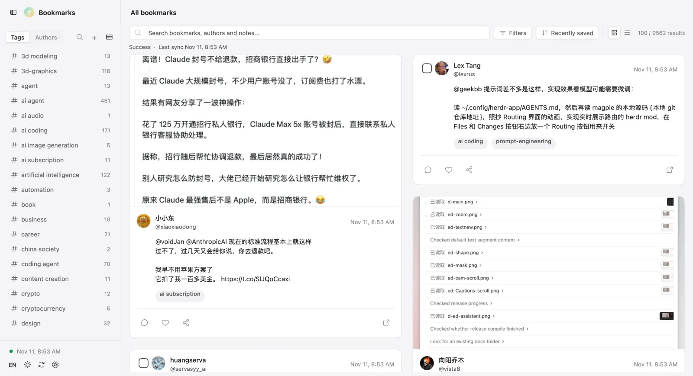

# trove

<a href="https://trove.taoquo.com"></a>

A local-first library for the bookmarks you already saved on X. Native macOS and Windows, plain
Go, one SQLite file on your own disk — no account, no sync server, no telemetry.

[](https://github.com/taoquo/trove/releases/latest)


[中文说明](./README.zh-CN.md) · [Download](https://github.com/taoquo/trove/releases/latest) · [Site](https://trove.taoquo.com)



## Is trove for you?

trove is for you if you save posts to read later and then never find them again, if you want them in
a file you can copy and keep, or if you would rather not hand a reading list to another account.

It is not for you if you save a handful of posts a year, if you need your bookmarks on a phone, or
if you want someone else's recommendations on top of them.

## What it does

- Sync every bookmark from X into local SQLite, resuming after an interruption instead of starting over.
- Browse, search and filter by text, tag, author, media and saved view.
- Organize with a tag library: aliases, parent tags, batch moves and merges.
- Suggest tags with keyword heuristics or your own model key; every suggestion waits for your yes.
- Read a post, its thread, the date you saved it and your own note without loading x.com.
- Import legacy `exportVersion: 2` JSON backups and export a native `.trovebundle`.
- Sign in, sync and export from a terminal: `trove auth`, `trove sync`, `trove export`.
- Stay bilingual (English / Simplified Chinese).

## Install

Download the build for your machine from the [latest release](https://github.com/taoquo/trove/releases/latest):

| Asset | Platform |
|---|---|
| `trove-macos-arm64.dmg` | macOS 12+, Apple silicon |
| `trove-macos-x64.dmg` | macOS 12+, Intel |
| `trove-windows-x64-setup.exe` | Windows 10/11, x64 |

On macOS, Homebrew can do the download and the update bookkeeping:

```bash
brew install --cask taoquo/trove/trove
```

macOS will ask you to confirm the first launch: right-click the app and choose **Open**. Windows may
show a SmartScreen prompt. Both are because the builds are not yet signed with a paid certificate —
see [Releases](#releases) for what is wired and what is not.

Every release carries `SHA256SUMS.txt` and a GitHub build attestation, so a download can be checked
against the workflow that produced it:

```bash
shasum -a 256 -c SHA256SUMS.txt
gh attestation verify trove-macos-arm64.dmg -R taoquo/trove
```

## Updates

From 0.3.1 on, trove updates itself. It checks in the background, shows the release notes of the new
version, and installs it on your word — **trove → Check for Updates…** asks right away, and the
preference to check automatically can be turned off. Updates are signed with an Ed25519 key that
ships inside the app, so a build that was not signed by this project's release workflow is refused.

An app installed by a package manager, or one you run from a build directory, cannot replace itself;
those are updated by the thing that installed them.

## Command line

The window is the app, but a few commands run without it:

```bash
trove auth            # open X, wait for the sign-in, save the session to the keychain
trove sync            # one sync; -full walks the whole timeline, -quiet prints only failures
trove export <file>   # write a .trovebundle backup
trove version
```

`trove auth` reads the cookies X sets in your browser, so on macOS the terminal running it
needs Full Disk Access (System Settings › Privacy & Security); without it the browser's
cookie database cannot be opened, and the command says so instead of waiting. `-no-open`
skips launching the browser, and `-timeout` shortens the five-minute wait.

The binary inside the app is the command: `/Applications/trove.app/Contents/MacOS/trove sync`. A
LaunchAgent runs it at 03:30 and logs what happened:

```xml
<?xml version="1.0" encoding="UTF-8"?>
<!DOCTYPE plist PUBLIC "-//Apple//DTD PLIST 1.0//EN" "http://www.apple.com/DTDs/PropertyList-1.0.dtd">
<plist version="1.0">
<dict>
  <key>Label</key><string>com.taoquo.trove.nightly</string>
  <key>ProgramArguments</key>
  <array>
    <string>/Applications/trove.app/Contents/MacOS/trove</string>
    <string>sync</string>
    <string>-quiet</string>
  </array>
  <key>StartCalendarInterval</key><dict><key>Hour</key><integer>3</integer><key>Minute</key><integer>30</integer></dict>
  <key>StandardOutPath</key><string>/tmp/trove-sync.log</string>
  <key>StandardErrorPath</key><string>/tmp/trove-sync.log</string>
</dict>
</plist>
```

On Windows, point Task Scheduler at `trove.exe sync -quiet`. A run that fails exits non-zero with the
reason on stderr, so the scheduler's log has an explanation rather than an absence.

## Requirements

- macOS 12 or later (Apple silicon or Intel), or Windows 10/11 x64.
- The pinned Go toolchain under `.toolchain/` (Go 1.27.4). It is mandatory: it fixes the version,
  forbids implicit toolchain switching and routes module downloads through a reachable mirror.
- Python 3 with Pillow for the screenshot-based checks.

## Build and run

Source the toolchain from bash (not zsh — `env.sh` locates itself through `BASH_SOURCE`):

```bash
bash -c 'source .toolchain/env.sh && go tool mygo build -skip-dmg'
```

The bundle lands at `build/darwin-arm64/trove.app`. Launch the binary directly rather than using
`open`, so a running instance cannot be reused by LaunchServices:

```bash
build/darwin-arm64/trove.app/Contents/MacOS/trove
```

To build both Mac architectures and the Windows installer, pass a platform list to MyGo:

```bash
go tool mygo build -platform darwin/arm64,darwin/amd64
go tool mygo build -platform windows/amd64
```

## Releases

Pushing a tag `v<version>` (matching `version` in `mygo.json`) runs
`.github/workflows/release.yml`, which builds both Mac architectures and the Windows installer,
writes the update archives and manifests, and attaches everything to a GitHub release. The three
installers keep the names the site links to; everything else carries MyGo's own names.

| Asset | Platform |
|---|---|
| `trove-macos-arm64.dmg` | macOS, Apple silicon |
| `trove-macos-x64.dmg` | macOS, Intel |
| `trove-windows-x64-setup.exe` | Windows, x64 |
| `SHA256SUMS.txt` | checksums of the three above |
| `trove-<version>-<platform>.tar.gz`, `update-<platform>.json` | what the app updates from |

Signing is wired but not yet switched on: with `MACOS_CERTIFICATE`, `MACOS_CERTIFICATE_PASSWORD` and
`MACOS_SIGNING_IDENTITY` the app is signed with a Developer ID, with `APPLE_ID`, `APPLE_TEAM_ID` and
`APPLE_APP_PASSWORD` the disk images are notarized and stapled, and without them the release is
ad-hoc signed and the workflow says so. Updates need `MYGO_UPDATER_PRIVATE_KEY`; without it a release
carries no update files. `docs/testing.md` lists the secrets and what each one changes.

Renaming an asset also means changing `FILES` in `site/public/app.js`.

## Test and verify

```bash
bash -c 'source .toolchain/env.sh && go test ./...'
```

The full quality gate is the canonical pre-commit check. It runs the source checkers,
`gofmt`/`go vet`/build, the test suite with and without the race detector, a MyGo build, a
launch/single-instance/quit smoke test, and two pixel checks against a live capture:

```bash
bash -c 'source .toolchain/env.sh && bash tools/gate.sh'
```

The pixel checks read captures under `docs/screenshots`, which are local-only.

## Repository layout

```text
cmd/trove             Composition root, window, menu, headless commands, capture entry point
internal/domain       Pure rules (no dependencies)
internal/ports        Interfaces the use cases need
internal/usecase      Workspace, tagging, sync, suggestions, settings
internal/storage      SQLite repositories and migrations
internal/xsource      X GraphQL client and query catalog
internal/llm          Model providers, adapters and errors
internal/autotag      Automatic tagging pipeline
internal/credentials  Keychain / Credential Manager and browser cookie reader
internal/media        Media download and disk cache
internal/bundle       Native .trovebundle format
internal/importexport Legacy JSON import and export
internal/ui           MyGo workspace and all drawing
cmd/mediaprobe        Development media diagnostic
cmd/seed              Seeds a fictional library for the site's screenshots
site/                 Static product page (Cloudflare Worker, deployed by hand)
tools/                Source checkers, capture tooling, quality gate
testdata/             Frozen equivalence fixtures
docs/                 Architecture, data, testing and design
```

Screenshots under `docs/screenshots/` are captured locally and are not versioned. The images this
README and the site show are captures of a seeded demo library: every account and post in them is
invented.

## Data and privacy

Bookmarks, tags and settings live in a local SQLite file. X credentials and LLM API keys are stored
in the macOS Keychain or Windows Credential Manager. No account, telemetry or hosted service is
involved.
