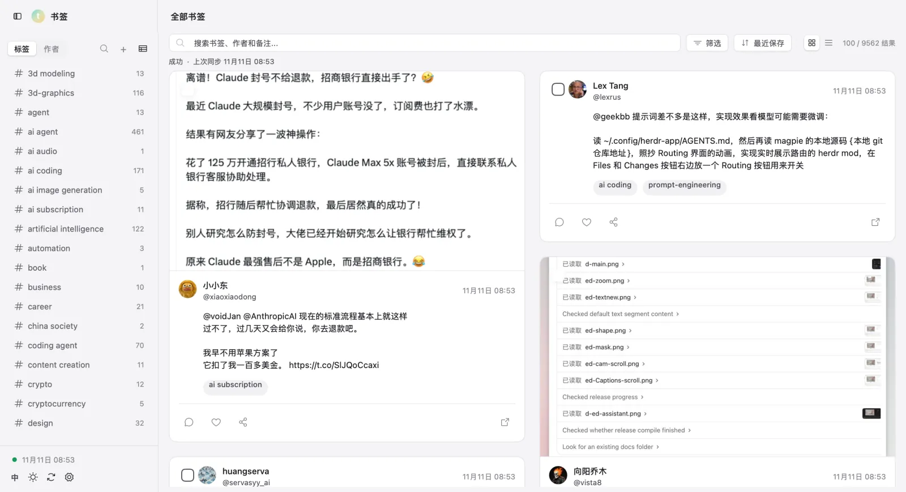

# trove

<a href="https://trove.taoquo.com"></a>

一个本地优先的书库，收好你在 X 上已经收藏的帖子。原生 macOS 与 Windows，纯 Go，数据是
你自己磁盘上的一个 SQLite 文件——没有账号，没有同步服务器，没有遥测。

[](https://github.com/taoquo/trove/releases/latest)


[English README](./README.md) · [下载](https://github.com/taoquo/trove/releases/latest) · [站点](https://trove.taoquo.com)



## 它适合你吗

如果你收藏了一堆「以后再看」却再也没找到过；如果你希望这些东西是一个能复制、能留住的文件；
如果你不想把阅读清单交给另一个账号——trove 适合你。

如果你一年只收藏几条、需要在手机上看书签，或者希望别人顺带给你推荐内容——那不需要 trove。

## 功能

- 把 X 上的书签全部同步到本地 SQLite，中断后从原处继续，而不是从头再来。
- 按正文、标签、作者、媒体和已保存视图浏览、搜索、筛选。
- 用标签库整理：别名、父标签、批量移动与合并。
- 用关键词启发式或你自己的模型 key 生成标签建议，每一条都要你确认后才生效。
- 不打开 x.com 就能读帖子、原串、收藏日期和你自己的批注。
- 导入旧版 `exportVersion: 2` JSON 备份，导出原生 `.trovebundle`。
- 用 `trove sync` 和 `trove export` 在定时任务里运行，不必开着窗口。
- 中英双语。

## 安装

从[最新 Release](https://github.com/taoquo/trove/releases/latest) 下载对应平台：

| 文件 | 平台 |
|---|---|
| `trove-macos-arm64.dmg` | macOS 12+，Apple 芯片 |
| `trove-macos-x64.dmg` | macOS 12+，Intel |
| `trove-windows-x64-setup.exe` | Windows 10/11，x64 |

macOS 上也可以用 Homebrew 下载：

```bash
brew install --cask taoquo/trove/trove
```

macOS 首次启动会要你确认：右键点应用，选**打开**。Windows 可能弹出 SmartScreen 提示。两种提示
都是因为构建还没有用付费证书签名——已接好什么、还缺什么见[发布](#发布)。

每个 Release 都带 `SHA256SUMS.txt` 和 GitHub 构建证明，可以核对下载的包是不是这条流水线产出的：

```bash
shasum -a 256 -c SHA256SUMS.txt
gh attestation verify trove-macos-arm64.dmg -R taoquo/trove
```

## 更新

从 0.3.1 起，trove 自己更新：后台检查，把新版本的发行说明摆出来，你点了才装。**trove →
检查更新…** 可以立刻查一次，自动检查的开关也可以关掉。更新用随应用打包的 Ed25519 公钥验签，
不是本仓库发布流水线签出的版本会被拒绝。

由包管理器安装的版本，或从构建目录直接运行的版本，不能替换自己——那种更新由安装它的东西负责。

## 命令行

窗口就是应用本体，但有两条命令不开窗，适合夜里跑：

```bash
trove sync            # 同步一次；-full 走完整条时间线，-quiet 只在失败时输出
trove export <文件>    # 写出一个 .trovebundle 备份
trove version
```

命令就是应用包里的那个二进制：`/Applications/trove.app/Contents/MacOS/trove sync`。下面的
LaunchAgent 每天 03:30 跑一次，并把输出写进日志：

```xml
<?xml version="1.0" encoding="UTF-8"?>
<!DOCTYPE plist PUBLIC "-//Apple//DTD PLIST 1.0//EN" "http://www.apple.com/DTDs/PropertyList-1.0.dtd">
<plist version="1.0">
<dict>
  <key>Label</key><string>com.taoquo.trove.nightly</string>
  <key>ProgramArguments</key>
  <array>
    <string>/Applications/trove.app/Contents/MacOS/trove</string>
    <string>sync</string>
    <string>-quiet</string>
  </array>
  <key>StartCalendarInterval</key><dict><key>Hour</key><integer>3</integer><key>Minute</key><integer>30</integer></dict>
  <key>StandardOutPath</key><string>/tmp/trove-sync.log</string>
  <key>StandardErrorPath</key><string>/tmp/trove-sync.log</string>
</dict>
</plist>
```

Windows 上用任务计划程序调用 `trove.exe sync -quiet`。失败的运行以非零状态退出，并把原因写到
stderr，所以计划任务的日志里有解释，而不是一片空白。

## 环境要求

- macOS 12 或更高（Apple silicon 或 Intel），或 Windows 10/11 x64。
- `.toolchain/` 下固定的 Go 工具链（Go 1.27.2）。这是强制要求：它固定版本、禁止隐式切换
  toolchain，并把模块下载指向可用的镜像。
- Python 3 与 Pillow（截图类检查需要）。

## 构建与运行

从 bash 载入工具链（不要在 zsh 里 source——`env.sh` 通过 `BASH_SOURCE` 定位自身）：

```bash
bash -c 'source .toolchain/env.sh && go tool mygo build -skip-dmg'
```

产物在 `build/darwin-arm64/trove.app`。请直接运行 bundle 里的二进制，不要用 `open`，否则
LaunchServices 可能复用已在运行的实例：

```bash
build/darwin-arm64/trove.app/Contents/MacOS/trove
```

要同时构建两种 Mac 架构和 Windows 安装包，给 MyGo 传平台列表：

```bash
go tool mygo build -platform darwin/arm64,darwin/amd64
go tool mygo build -platform windows/amd64
```

## 发布

推送与 `mygo.json` 中 `version` 一致的 `v<version>` 标签，`.github/workflows/release.yml` 会构建
两种 Mac 架构与 Windows 安装包、生成更新包与清单，并全部挂到 GitHub Release。三个安装包沿用
站点链接的文件名，其余文件用 MyGo 自己的命名：

| 文件 | 平台 |
|---|---|
| `trove-macos-arm64.dmg` | macOS，Apple 芯片 |
| `trove-macos-x64.dmg` | macOS，Intel |
| `trove-windows-x64-setup.exe` | Windows，x64 |
| `SHA256SUMS.txt` | 上面三个文件的校验和 |
| `trove-<version>-<platform>.tar.gz`、`update-<platform>.json` | 应用自更新所读的文件 |

签名已经接好但还没打开：有 `MACOS_CERTIFICATE`、`MACOS_CERTIFICATE_PASSWORD` 和
`MACOS_SIGNING_IDENTITY` 时用 Developer ID 签名，再有 `APPLE_ID`、`APPLE_TEAM_ID` 和
`APPLE_APP_PASSWORD` 时对磁盘映像做公证并 stapling；缺这些时构建是 ad-hoc 签名，流水线会在
运行摘要里明说。自更新需要 `MYGO_UPDATER_PRIVATE_KEY`，缺它时发布不携带更新文件。每个 secret
改变什么，见 `docs/testing.md`。

改名要同时改 `site/public/app.js` 的 `FILES`。

## 测试与验收

```bash
bash -c 'source .toolchain/env.sh && go test ./...'
```

完整门禁是提交前的标准检查，包含源码检查器、`gofmt`/`go vet`/构建、带与不带 race detector 的
测试、MyGo 构建、启动/单实例/退出冒烟测试，以及两项基于实时截图的像素检查：

```bash
bash -c 'source .toolchain/env.sh && bash tools/gate.sh'
```

像素检查读取 `docs/screenshots` 下的截图，该目录只在本地保留。

## 仓库结构

```text
cmd/trove             组合根、窗口、菜单、无窗口命令与截图入口
internal/domain       纯规则（无依赖）
internal/ports        用例所需的接口
internal/usecase      工作区、标签、同步、建议、设置
internal/storage      SQLite 仓库与迁移
internal/xsource      X GraphQL 客户端与查询目录
internal/llm          模型供应商、适配器与错误
internal/autotag      自动打标流水线
internal/credentials  Keychain / Credential Manager 与浏览器 cookie 读取
internal/media        媒体下载与磁盘缓存
internal/bundle       原生 .trovebundle 格式
internal/importexport 旧版 JSON 导入与导出
internal/ui           MyGo 工作区与全部绘制
cmd/mediaprobe        开发用媒体诊断命令
cmd/seed              用虚构书库为站点截图播种数据
site/                 静态产品页（Cloudflare Worker，手动发布）
tools/                源码检查器、截图工具、质量门禁
testdata/             冻结的等价性 fixture
docs/                 架构、数据、测试与设计
```

`docs/screenshots/` 下的截图只在本地生成，不纳入版本控制。README 与站点上的截图来自一份播种的
演示书库：里面每个账号和帖子都是虚构的。

## 数据与隐私

书签、标签与设置保存在本地 SQLite 文件。X 凭据与 LLM API key 保存在 macOS Keychain 或 Windows Credential Manager。没有账号、遥测或
托管服务。
